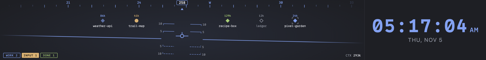

# Cockpit

[](https://github.com/NJordan72/cockpit/actions/workflows/check.yml)

A macOS app for running Claude Code and Codex side by side. Each agent runs in
its own terminal with its usual interface, and Cockpit adds what goes around
them: tabs, splits, and presets; a status for every pane (working, needs
input, done) with notifications; tasks, which give each agent a branch and a
git worktree of its own; an Activity panel that shows what each agent
read, changed, and ran; and a sidebar of sandboxed widgets that can call out
to services like Shortcut. Layouts arrange the window, and themes style it.

It's a personal project, built around one person's setup. It runs on Apple
silicon Macs. It was built with Claude Code, working from
[INSTRUCTIONS.md](INSTRUCTIONS.md): the build plan, plus a status note for
every feature as it landed.

## Install

Download the `.dmg` from the
[latest release](https://github.com/NJordan72/cockpit/releases/latest), open
it, and drag Cockpit to Applications.

Releases from 0.3.0 on are signed with a Developer ID and notarized by Apple,
so they open like any other app. 0.2.0 isn't: the first time you open it,
macOS says it can't verify the app. Click **Done**, then open
**System Settings > Privacy & Security**, scroll down to the message about
Cockpit, and click **Open Anyway**.

### Updates

Cockpit checks for a new release a minute after it opens and every four hours
after that, and downloads it in the background. When the download is done,
it asks whether to restart into the new version. A restart closes every
terminal and ends what's running in it, so the dialog says how many terminals
are open and how many agents are working or waiting for you. When any are,
**Later** is the default. **Later** installs the update the next time you quit
Cockpit, and **Cockpit > Restart to Install** asks again. To check right away,
choose **Cockpit > Check for Updates…**.

Updates need a release signed with the same Developer ID as the copy you're
running, so 0.2.0, which has no updater, and builds from source don't update
themselves. Install 0.3.0 or later from the release page once, and updates
come by themselves after that.

### From source

Requires macOS, [mise](https://mise.jdx.dev), and Xcode Command Line Tools
(for the `node-pty` native build). `mise install` sets up the bun and Node
versions pinned in `mise.toml`; Node matches the version inside Electron.

```sh
mise install
bun install
```

`postinstall` downloads the Electron binary and rebuilds `node-pty` against
Electron's ABI. If the terminal fails to start after an Electron upgrade, run
`bun run postinstall` again.

## Run

```sh
bun run dev     # electron-vite dev server with hot reload
bun run build   # production build into out/
bun run start   # run the production build
```

Panes run their commands through a login shell (`$SHELL -l`), so `claude`,
`codex`, and anything else on your login PATH work as usual.

## Start screen

Cockpit opens on a list of your projects: the folders in `~/dev`, plus recent
directories elsewhere, most recently used first. "Used" counts a Cockpit pane
started there, and Claude Code or Codex run there from anywhere (Cockpit reads
when each last wrote to its transcripts in `~/.claude/projects/` and its
session logs in `~/.codex/sessions/`). Each row says which agent ran last and
how long ago.

The switch at the top picks the agent (`Tab` flips it), and `Enter` or a click
opens the selected project in a new tab with that agent. The switch remembers
the agent you launched last. Type to filter, or type a path starting with `~`
or `/`. The switch lists every preset with a command (Claude Code and Codex by
default).

If the last session left tabs open, **Restore last session** brings them back
instead. Launching a project starts fresh, and the old layout is gone. Closing
the last tab returns to the start screen.

## Tabs, splits, presets

`Cmd+T` opens a picker: choose a preset with `Tab` (Shell, Claude Code, Codex
by default), pick a directory (the current pane's, then the start screen's
list), and press `Enter`. Type to filter, or type a path starting with `~` or
`/`. Split keys open the same picker, starting in the focused pane's directory
and preset. Drag a tab along the tab bar to move it.

Right-click a tab to rename it, give it a color strip, or pin it to the right
end of the tab bar (double-click also renames; an empty name goes back to the
automatic one). Pinned tabs stay together on the right, have no close button,
and are numbered after the others for Cmd+1 … Cmd+9. Use them for tabs that
run one job for a long time, named for that job.

When tabs come from more than one project, the funnel after `+` filters them by
folder: uncheck a folder, or pick **Show only**, to hide its tabs. A tab's
folder is the one under `projectsDir` it started in (`~/dev/cockpit` for a
shell opened in `~/dev/cockpit/src`), or its directory outside `projectsDir`.
Pinned tabs always show, and so does the active tab, in italics, while its
folder is hidden. The tab shortcuts skip hidden tabs, the button counts them,
and opening a new tab in a hidden folder shows that folder again. Each window
keeps its own filter.

The layout (tabs, splits, sizes, each pane's preset and directory) is saved to
`~/.cockpit/config.json` for each window, and the start screen offers to restore it on
relaunch. Processes and scrollback are not restored; each pane starts its
preset fresh in the directory it was last in. When a pane's process exits, the
pane shows the exit status; press `Enter` to restart it.

A pane can also show a web page: Cmd+L (or Web in the toolbar) takes a URL, a
bare host (`example.com`, `localhost:5173`), or a file path
(`/Users/me/deck/dist/index.html`). The pane has back, forward, reload, an
address field, and ↗ to open the page in your browser. Pages run sandboxed
with no access to Cockpit, keep their cookies in their own partition, open
new windows in the browser, and are reopened on restore at the page they were
on. Cmd+R reloads the focused page. The Cmd+T picker's Web option lists the 20
pages most recently loaded in web panes; type to filter them, or type a new
address.

| Key (default)       | Action                                     |
| ------------------- | ------------------------------------------ |
| Cmd+T               | New tab (picker)                           |
| Cmd+Shift+T         | New shell tab, no agent, in the same dir   |
| Cmd+Shift+N         | New task (see [Tasks](#tasks))             |
| Cmd+L               | Open a web page (new tab, or ⇧⏎ to split)  |
| Cmd+R               | Reload the focused web page                |
| Cmd+D / Cmd+Shift+D | Split right / down (picker)                |
| Cmd+W               | Close pane (last pane: tab)                |
| Cmd+Shift+Backspace | Clear pane: restart its preset fresh       |
| Cmd+Shift+R         | Resume: pick an old session for the pane   |
| Cmd+Shift+E         | Open the pane's project in your editor     |
| Cmd+Shift+P         | Read the pane's plan (see [Plans](#plans)) |
| Cmd+Alt+Arrow       | Move focus between panes                   |
| Cmd+Shift+] / [     | Next / previous tab                        |
| Cmd+1 … Cmd+9       | Go to tab                                  |
| Cmd+B               | Hide or show every panel but the terminals |

The toolbar along the bottom of the window shows the focused pane: its status,
preset (or Claude Code's name for the conversation), directory, and git branch
with commits ahead and behind and the number of changed files, and a Plan
button once its agent has proposed a plan (see [Plans](#plans)). Its buttons open
a new tab, a plain shell tab (no agent) in the focused pane's directory, a new [task](#tasks), split right or down, clear the pane, and hide or show the panels, and its menu
switches layouts. Clear ends the pane's process and starts its preset again in
the same directory, with a new terminal and an empty status, activity log, and
file list; the old conversation stays in Claude Code's or Codex's own history.
Resume does the same, but starts the agent at its own list of past sessions
in that directory (`claude --resume`, `codex resume`) so you can pick one up again.
Editor opens the focused pane's project, which is its git repository or, outside
one, its directory, with the `editor` command from `config.json` (see
[Config](#config)). Hover a button to see its shortcut. The toolbar stays put
when Cmd+B hides the panels, so the Panels button can bring them back.

## Agent awareness

Every pane has a status: **idle**, **working**, **needs input**, **done**
(finished a turn you haven't looked at), or **exited**. A tab shows a dot for
the most urgent status among its panes (idle gets none), and the **Sessions**
panel shows every pane with its status, Claude Code's
title for the conversation, and how many tokens its context holds. Click a
session to jump to it. When a pane goes to needs input or done while
Cockpit's window isn't focused, macOS shows a notification; clicking it
focuses that pane. The Dock icon's badge counts the panes that need you.

How each kind of pane is followed:

- **Claude Code** (a preset whose command starts with `claude`): Cockpit adds
  `--settings ~/.cockpit/agents/claude-settings.json`, which registers hooks
  (SessionStart, UserPromptSubmit, PreToolUse, PermissionRequest, PostToolUse,
  Notification, Stop, and a few more) that run `~/.cockpit/agents/cockpit-hook`.
  The script sends each hook's payload to a Unix socket under
  `~/.cockpit/run/` and prints nothing, so Claude behaves exactly as before.
  These hooks add to your own; `~/.claude/settings.json` isn't touched.
  Claude holds hooks back in a folder you haven't trusted yet.
- **Codex** (a command starting with `codex`): Cockpit adds `-c` overrides
  that make Codex put its run state in the terminal title and send OSC 9
  notifications when a turn ends or it wants approval, and reads both from the
  pane's output. `~/.codex/config.toml` isn't touched. Any `-c` makes Codex
  run without its shared background server (it says so in a startup warning),
  so these sessions don't show up in `codex agents`.
- **Anything else**: a pane that keeps printing for a second is working, and
  one that has been quiet for a few seconds is idle. Typing and redraws after
  a resize don't count.

A dialog counts as answered when you press Enter, Esc, or a number key (which
picks that option in Claude Code's dialogs), or when the tool call it asked
about finishes, and a reminder Claude sends after you answered doesn't bring
needs input back.

Agent awareness needs the preset's command to start with `claude` or `codex`
(optionally after `VAR=value` settings). Running `claude` by hand in a Shell
pane gets the output heuristic only. Interrupting a turn with Esc sends no
hook, so an interrupted Claude turn turns idle once its spinner has been still
for 10 seconds.

Notifications need macOS to allow them for the app. The unsigned development
build (`bun run dev`, `bun run start`) runs as "Electron", which macOS 27
refuses ("UNErrorDomain error 1"); Cockpit then bounces the Dock icon instead
and logs a warning once.

Set `COCKPIT_AGENT_LOG=/path/to/file` to log every agent event and what it
did to the pane's status (event names and statuses only; no payloads or
message text).

## Activity

The **Activity** panel under the Sessions list shows what the focused pane's
agent has been doing. Click a session to switch to it. The panel has four
tabs, each with a count:

- **Log**: one line per event, newest at the bottom. It lists sessions
  starting and ending, your prompts, tool calls with their command or file,
  permission requests, failures, subagents starting and finishing,
  notifications, and finished turns. Calls made inside a subagent are marked
  ↳. Click a line to read all of it, such as a multi-line command or Claude's
  whole reply. **Events** and **Tools** filter the list.
- **Files**: the files Claude read or changed, most recent first, with lines
  added and removed. `A` marks a new file, `M` an edited one, and `R` one that
  was only read.
- **Agents**: the subagents Claude started, with the description Claude gave
  each one, its tool calls, how long it ran, and the first line of its result.
  `bg` marks a subagent that ran in the background.
- **Git**: the branch, how far it is ahead of or behind its upstream, changed
  and untracked files, and the last five commits. Cockpit reads them from the
  directory the agent works in (a shell's current directory, for Shell panes)
  a second after the agent does something, every 10 seconds while the panel
  shows, and when the window comes forward.

Claude Code panes fill every tab, from the same hooks that drive their status
plus SubagentStart and SubagentStop. Codex panes log the start and end of each
turn and its approval requests, which is all Codex reports through the
terminal, so their Files and Agents tabs stay empty. Shell panes only have
Git. The log is kept in memory, never written to disk, and never shown to
widgets. Each pane keeps its newest 1,000 entries until the pane closes or
Cockpit quits.

Drag the line under the panel to resize it, or fold it with ▾. Its size, tab,
and folded state are saved with the layout (see [Themes and
layouts](#themes-and-layouts)). When no widget below it takes up height, the
panel fills its column.

Right-click a line in the Log for what you can do with it:

- A Bash call: **Copy command** copies the whole command. **Run in a new
  terminal** opens a Shell tab in the directory Claude ran it in and runs it
  there, as if you had pasted it at the prompt. If that directory is gone, the
  tab says so and runs nothing.
- A Read, Edit, or Write call: **Open in editor** or **Copy path**. Files in the
  Files tab have the same menu.
- An ExitPlanMode call: **Show plan** opens that plan (see [Plans](#plans)),
  and **Open in editor** and **Copy path** act on the plan file.
- One of your prompts: save it as a slash command (see below), or copy it.

### Plans

When Claude Code finishes planning and asks you to approve its plan, Cockpit
keeps a copy for the rest of the session. A **▤ Plan** button appears in the
toolbar for that pane. Its mark is yellow while the plan waits for your answer
and green once you approve it. Click it, or press Cmd+Shift+P, to read the plan
over the window as formatted Markdown. Esc or a click outside closes it.

The plan view shows when Claude proposed the plan, whether you approved it,
and how many rounds it took if you asked for changes. **Open** opens the plan
file (`~/.claude/plans/<name>.md`) in your editor, and **Copy** copies the
Markdown; right-click for the same and to copy a selection. A session that
made more than one plan shows a count on the button and **1 of 2 ▾** to pick
another.

Plans stay through `/clear`, so a plan is still there while Claude carries it
out in a fresh conversation. Toolbar Clear and closing the pane drop them, as
does quitting Cockpit, though the plan files stay in `~/.claude/plans/`.
Claude Code sends no hook when you turn a plan down, so a plan you didn't
approve stays marked as proposed. Raw HTML in a plan shows as text, images show
as their alt text, and only http(s) links open, in your browser.

## Pull requests and commands

Two panels share a tab group under Activity.

**Pull requests** lists the open pull requests of the focused pane's
repository, read with `gh pr list` every minute while it shows, so it uses your
own `gh` login. The dot is the checks (green passing, yellow running, red
failing), and the second line shows the author, draft, review state, and age.
**All**, **Mine**, **To review** (you're a requested reviewer), **Others**,
and **Bots** (authors gh marks as bots, or with `[bot]` or `app/` in the
name) filter it. Click a pull request to open it on GitHub. Right-click it to
send a prompt about it, in a new agent tab or in the focused pane. The prompts
come from `prActions` in `config.json` (see [Config](#config)). Each is a
command with the PR's URL added at the end, and the default is one,
**Review**, which sends `/code-review <url>`.

**Commands** lists Claude Code slash commands from the repository's
`.claude/commands/` and from `~/.claude/commands/`. Click one to run it in the
focused pane (or in a new tab, when the focused pane runs no agent);
right-click for more. **+ Save a prompt** offers the focused pane's last dozen
prompts. Saving opens a form for the name, an optional description (shown in
Claude's `/` menu), the prompt itself, and where it goes: everywhere or just
this repository. Cockpit writes an ordinary command file, so the command also
works in Claude Code outside Cockpit. The Activity log keeps the first 4,000
characters of a prompt, so a longer one is saved cut short.

A new agent tab opens in the focused pane's directory with its preset when
that pane runs an agent, and with the first Claude Code preset otherwise. It
starts with the prompt already sent. Sending to an existing pane pastes the
prompt and presses Enter.

These panels came after the built-in layouts were saved, so a layout you've
changed doesn't have them until View > Reset Layout (or until you add them by
hand; see [docs/layouts.md](docs/layouts.md)).

## Tasks

Two agents in the same checkout edit the same files and step on each other's
diffs. A task gives an agent a branch of its own in its own git worktree, so
several agents can work in one repository at once.

**New task** asks for a branch, a repository, an agent, and an optional first
prompt. The repository starts as the focused pane's. To open the dialog, press
Cmd+Shift+N, click the toolbar's **⎇ Task** or **+ New task** in the Tasks
panel, or press Cmd+Enter on a folder in the Cmd+T picker. Cockpit fetches
from the repository's remote, then makes the worktree in
`~/.cockpit/worktrees/<repository>/<branch>`:

- A new branch starts at the remote's default branch (`origin/main`, say),
  with no upstream, so the first `git push -u` sets one.
- A branch that exists locally is checked out as it is. A branch that's only
  on the remote is checked out tracking it.
- A branch that has a task already opens that task's worktree. A branch
  that's checked out anywhere else is refused.

The tab opens in the worktree with the agent and the prompt. In the Shortcut
widget, right-click a story and choose **Start story in a new task**. The
dialog opens with the widget's start prompt and the story's branch filled in.
The branch is the name Shortcut suggests for the story, which is also the name
`/start-story` uses.

A new worktree has only the files git tracks. `tasks` in `config.json` sets up
the rest for each repository, keyed by its main checkout:

```jsonc
"tasks": {
  "~/dev/cockpit": { "setup": "bun install", "copy": [".env", "apps/web/.env.local"] }
}
```

`copy` lists files and folders, relative to the repository, that are copied
from the main checkout into each new worktree. `setup` runs in the task's
first terminal before the agent starts, so you see its output. If it fails,
Cockpit says so and starts the agent anyway. mise trusts a worktree of a
checkout it trusts, so tools pinned in `mise.toml` work there without another
`mise trust`. Claude Code and Codex may ask whether to trust the new folder
the first time an agent starts in it.

The **Tasks** panel, in the tab group with Pull requests, lists every task,
newest first. Each row shows the branch, the repository, how many terminals
are open in the worktree, how many files have uncommitted changes, how many
commits are on no remote, and the pull request. Cockpit reads pull requests
with `gh pr list --head <branch>` about once a minute while a window is on
screen, and stops asking about a pull request once it has merged. Click a task to show
its pane, or to open its agent when no pane is open there. Right-click a task
to open another preset in it, open its pull request, open its folder in your
editor, copy its path or branch, or remove it.

Outside the panel, a session in a task shows its branch and pull request in
the Sessions list. A task's tabs belong to their repository's folder in the
tab bar's folder filter, and the start screen lists the repository instead of
each worktree.

**Remove…** deletes the worktree and closes its terminals. Cockpit asks first
when any of these is true:

- Files have uncommitted changes. Removing the task discards them.
- The branch has work GitHub hasn't merged. The branch is kept.
- Terminals are open in the worktree.

The local branch is deleted only when its pull request merged with nothing
newer on the branch. Squash merges count, because Cockpit compares the branch
with the pull request's head commit rather than with `main`. **Clean up
merged** removes every such task after one question.

A layout you changed before Tasks existed gets the panel once, next to Pull
requests, when Cockpit first reads it.

## Widgets

Widgets are small HTML pages, each in its own sandboxed iframe, that reach the network, secrets, and storage only through an
API that checks their manifest. Put a widget folder (or a symlink to one) in
`~/.cockpit/widgets/`; Cockpit picks it up and reloads it whenever its files
change. To install the examples:

```sh
examples/widgets/install.sh                    # all of them
examples/widgets/install.sh shortcut-stories   # just one
```

`hello` calls every API and is the place to start a new widget.
`shortcut-stories` lists your Shortcut stories. The first time it runs,
Cockpit asks for a Shortcut API token and keeps it encrypted; see
[its README](examples/widgets/shortcut-stories/README.md). Right-click a story
to start an agent on it, in a new tab, in any open agent pane, or in a new
[task](#tasks). The widget's
gear sets the prompt that sends and adds tabs of your own Shortcut searches.
When a pane's git branch names a story (`nick/sc-1234/fix-login`), a line at
the top of the pane shows the story's number, title, points, state, and
owners; hover it for more, and click it to open the story. Any widget with
`"sessions": "label"` can put a line there.

New widgets go into the layout's Widgets group, stacked by default. Each one
collapses from its header, and the line between two widgets drags to resize
them. The button at the right of the group's title switches it to one widget
per tab. All of that is saved with the layout, and a layout can put any
widget somewhere else.

Writing a widget, the manifest, and the full API: [docs/widgets.md](docs/widgets.md).

## Themes and layouts

View > Theme switches between themes: Midnight (the default), Amber (cream
and amber on black, with CRT scanlines), Paper (light), and any in
`~/.cockpit/themes/`. A theme sets colors, fonts, corners, panel spacing, and
the terminal's palette, and can bring a stylesheet, images, and fonts of its
own. [docs/themes.md](docs/themes.md) explains how to make one.

View > Layout arranges the window:

- **Classic**: the tab bar across the top, the terminals, and on the right
  Sessions, Activity, and widgets.
- **Cockpit**: a banner and a clock across the top, Activity on the left, and
  Sessions, a System monitor, and widgets on the right. The banner is
  `~/.cockpit/images/banner` (a GIF, PNG, or other image) if you have one,
  and otherwise a head-up display whose traffic is your agent sessions, with
  lights for the ones working, waiting for you, and done:

  

- **Panels (no terminals)**: for a second or third window (see [Windows and
  displays](#windows-and-displays)).

Every line between two panels drags, and panels in a column fold from their
title. Changes are saved as your own copy of that layout; View > Layout >
Reset Layout goes back to the built-in one. Layouts can also be written in
`config.json`, from these panels: the terminals, the tab bar, Sessions,
Activity, any widget, a clock, an image or GIF from `~/.cockpit/images/`, and
a System monitor (CPU, memory, load, uptime). Hand edits apply while Cockpit
runs, and terminals and widgets keep running when the layout changes.
[docs/layouts.md](docs/layouts.md) has the format.

View > Open Cockpit Folder opens `~/.cockpit` in Finder.

## Windows and displays

The ▭ 1 2 3 switch at the right of the toolbar (or Window > One, Two, Three
Windows) sets how many Cockpit windows are open and puts them on the displays:
one per display while there are enough, filling it, and side by side on the
biggest display past that. Windows that are already on a display stay on it.
Picking the number already selected arranges the windows again. Going down
closes the newest windows first, and asks before ending terminals in them.

Each window has its own tabs and its own layout, so a side display can run
**Panels**, a layout with no terminals: clock, Sessions, System, pull
requests, and commands on the left, Activity in the middle, widgets on the
right. Activity, pull requests, commands, and the toolbar there follow the
pane you last worked in, in whichever window. Shortcuts pressed in a Panels
window (Cmd+T, Cmd+D, ...) go to the window with terminals you used last.

A widget runs in one window only: the first whose layout places it. Widgets
no layout places go to the first window without terminals, or else the first
window. Two windows on the same layout share it, so dragging a divider in one
moves it in the other.

Every window's tabs, layout, and place are saved, and a relaunch reopens each
on the display it was on. When a display is unplugged, macOS moves its window
to another one; when the display comes back, the window goes back to it.
Closing a window with its red button ends its terminals and forgets it, except
the last one, which the start screen offers to restore as before.

## Kids mode

Kids mode turns the window into a pretend terminal for a small child who wants
to work like you. Press Cmd+Shift+K or choose View > Kids Mode. The window goes
full screen in macOS kiosk mode, and a terminal in your font and colors takes
the terminals' place, with a welcome box and a `>` prompt. It has its own tab in
the tab bar. The rest of the window stays on screen but can't be clicked.

What the keys do:

- A letter shows big in the middle of the terminal, appears at the prompt in a
  random color, and brings out a character for that letter (B is a bear 🐻).
  The character walks, jumps, spins, dances, floats up, or zooms. After a
  pause in typing, a voice says "B is for bear".
- A digit shows that many of one character in a row, so 3 shows three of them
  to count. 0 shows ten.
- Enter submits the line. A spinner like Claude Code's runs for a second or two
  (`✻ Giggling…`), then the answer lists what was typed and those characters
  parade across the screen. A full line submits by itself.
- Space sends a character walking across, Backspace deletes, and other keys
  make sparkles. A click brings out a character where the pointer is.

Every key also plays a note. With `"sound": "songs"` (the default), each key
plays the next note of a nursery rhyme, so mashing keys plays Twinkle Twinkle,
then Mary Had a Little Lamb, Old MacDonald, Row Row Row Your Boat, and Itsy
Bitsy Spider. With `"notes"`, each key has its own note on a pentatonic scale,
rising from left to right like a xylophone.

To leave, type the exit word, `grownup` unless you change it. It's printed
small at the right end of the tab bar.

### Favorite characters

Put image files (PNG, JPEG, GIF, WebP, AVIF, or SVG) in `~/.cockpit/kids/`.
The file name is the character's name, and its first letter is the key that
brings it out. With `bluey.png` there, B brings out Bluey instead of the bear,
the voice says "B is for Bluey", and the answer line names Bluey. Animated GIFs
play. Space, digits, clicks, and empty-line parades pick from your pictures
most of the time. The folder is read each time kids mode starts, and files over
8 MB are skipped.

### What stays safe

Your panes keep running behind it. While kids mode is on:

- The main process drops all input to PTYs, so nothing typed reaches Claude
  Code, Codex, or a shell, even if a key got past kids mode.
- Kiosk mode turns off Cmd+Tab, force quit, hiding, and the Dock. The menu is
  replaced by one with no shortcuts, so Cmd+Q, Cmd+H, and Cmd+M do nothing, and
  Cockpit ignores its own shortcuts such as Cmd+W and Cmd+T.
- Panels and widgets stay on screen and keep updating, but they can't be
  clicked or focused, and a widget's secret prompt waits until you leave.
- Notifications aren't shown. A pane that finished or asked for permission
  meanwhile still has its badge when you leave.

Keys that macOS handles itself still work in kiosk mode, such as the volume
and brightness keys, Spotlight, and the power button. Kiosk mode covers only
the display the window is on.

### Settings

Under `kids` in `config.json`, read each time kids mode starts:

- `name`: shown in the welcome box ("Welcome, Ava!") and on the tab.
- `exitWord`: 5 to 32 lowercase letters. Anything shorter or invalid falls
  back to `grownup`, since a child mashing keys could type a short word by
  chance.
- `volume`: 0 to 1, for both the notes and the voice.
- `sound`: `songs` or `notes`.
- `speak`: `false` turns the voice off.

The `kidsMode` keybinding changes the shortcut.

## Config

`~/.cockpit/config.json` is created on first launch with every option filled
in. Edits are picked up while the app runs (keybindings, presets, font).
Invalid values fall back to defaults; a file that isn't valid JSON is copied
to `config.json.broken-<time>` before being replaced.

```jsonc
{
  "presets": [
    { "id": "shell", "name": "Shell", "cwd": "~" },
    { "id": "claude", "name": "Claude Code", "command": "claude", "cwd": "~/dev" },
    { "id": "codex", "name": "Codex", "command": "codex", "cwd": "~/dev" }
  ],
  "keybindings": { "newTab": "Cmd+T", "splitRight": "Cmd+D" /* ... */ },
  "terminal": { "fontFamily": "...", "fontSize": 13, "scrollback": 5000 },
  "appearance": {
    "theme": "midnight",
    "overrides": { "accent": "#ff9e64" },
    "layout": "classic",
    "layouts": {/* your changed or hand-written layouts */},
    "panelsHidden": false
  },
  "projectsDir": "~/dev",
  "launcher": { "presetId": "claude" },
  "kids": { "name": "", "exitWord": "grownup", "volume": 0.6, "sound": "songs", "speak": true },
  "editor": "zed",
  "prActions": [{ "label": "Review", "command": "/code-review" }],
  "tasks": { "~/dev/cockpit": { "setup": "bun install", "copy": [".env"] } }
}
```

Preset commands run as `$SHELL -l -c <command>`, so they get the PATH from
your login files (`.zprofile`, `.zshenv`), even when Cockpit is started from
the Dock. Keybindings take `Cmd`, `Ctrl`, `Alt`/`Option`, `Shift` plus a key
(`A`–`Z`, `0`–`9`, `F1`–`F20`, `Left`/`Right`/`Up`/`Down`, `Enter`, `Tab`,
`Esc`, `[`, `]`, and other punctuation); an empty string unbinds an action.
`terminal.fontFamily` is a CSS font stack. 0xProto Nerd Font Mono ships with
the app and is the default, and Symbols Nerd Font Mono is added to the end of
every stack, so Nerd Font prompt icons (Starship, Powerlevel10k) show up in
whatever font you pick.
`appearance.theme` picks a theme (also in View > Theme), and
`appearance.overrides` changes single tokens of it (`bg`, `fg`, `accent`,
`radius`, ...); see [docs/themes.md](docs/themes.md). `appearance.layout`
picks a layout, and `appearance.layouts` holds the ones you changed or wrote;
see [docs/layouts.md](docs/layouts.md). A config from before version 3 is kept
as `config.v2.json` when Cockpit first rewrites it; its sidebar settings become
your copy of the Classic layout.
`editor` is the command that opens files and projects from the Activity panel
and the toolbar (`zed`, `code -g`, `cursor`). It runs through the login shell
like a preset command, with the path added at the end. Leave it `null` (the
default) to open files in their default app and projects in Finder.
`prActions` is what the Pull requests panel's right-click menu can send about
a pull request: a `label` for the menu and a `command`, which gets the PR's
URL added at the end. Point them at your own skills or slash commands, such as
`{ "label": "Ship", "command": "/ship-pr" }`. An empty list leaves only Open
on GitHub and Copy URL.
`tasks` sets up each repository's new task worktrees; see [Tasks](#tasks).
Set `COCKPIT_HOME` to use a different directory than `~/.cockpit`.

## Terminal keys

| Key           | Does                                                      |
| ------------- | --------------------------------------------------------- |
| Shift+Enter   | Newline without submitting (sends ESC CR, like Opt+Enter) |
| Option        | Acts as Meta (Alt+b, Alt+f, ...)                          |
| Cmd+C / Cmd+V | Copy selection / paste (bracketed paste when enabled)     |
| Cmd+K         | Clear the screen and scrollback                           |

Click a URL to open it in the browser. Click a file path (`~/deck/index.html`,
`/etc/hosts`, `src/app.ts:12`, `slides/`) to open it in its default app, or a
folder in Finder. Relative paths resolve against the pane's current directory,
and only paths that exist get underlined.

## Checks

```sh
bun check        # typecheck the node, web, and test projects
bun fmt          # format; bun fmt --check only reports
bun test         # run the tests; bun run test runs them in parallel
bun run lint     # ESLint
bun run lint:actions   # actionlint and zizmor on .github/
bun run lint:shell     # ShellCheck on the shell scripts
bun run verify   # all of the above, the way CI runs them
bun run build && bun run smoke   # launch the built app and run a command in a shell
bun run package:app && bun run smoke dist/mac-arm64/Cockpit.app   # the same, packaged
```

actionlint checks the workflows' syntax and expressions, and runs ShellCheck
on their `run:` steps. zizmor looks for security problems in them, such as
an action that isn't pinned to a commit or untrusted input expanded into a
script; with `GH_TOKEN` set, as in CI, it also checks the pinned actions
against GitHub's advisories. `mise.toml` pins all three tools, so `mise install`
sets them up.

`bun check`, `bun fmt`, and `bun test` are bun's built-in type checker,
formatter, and test runner. `bun fmt` follows `.prettierrc.json` and
`.prettierignore`, so its output matches Prettier's. Tests sit next to the code
they test as `*.test.ts` and import from `bun:test`. `test/setup.ts` stands in
for the `electron` module, which only works inside Electron. Test files are
typechecked as their own project, `tsconfig.test.json`, which is the only one
with Bun's types.

TypeScript runs in strict mode with `noUncheckedIndexedAccess`, and ESLint
uses typescript-eslint's `strictTypeChecked` rules with zero warnings allowed.

`bun run smoke` (`scripts/smoke.mjs`) starts the built app with a scratch HOME,
`COCKPIT_HOME`, and Chromium profile, opens a shell from the start screen, and
fails unless a command's output reaches the terminal and the renderer logs no
errors. It never touches your real config. Given the path to a packaged
`Cockpit.app`, it runs that instead, and also checks that the app can load its
icon from inside `app.asar`.

GitHub Actions runs:

- `check` on every pull request and push to `main`: `bun run verify`, the
  build, and the smoke test against `out/` and against the packaged app, on
  macOS. On pull requests, a `changeset` job also fails a PR that changes the
  app without a changeset (see [Releases](#releases)).
- `release` on every push to `main`: opens the Version Packages PR, or
  packages and publishes a release once that PR is merged.
- `audit` on changes to `package.json` or `bun.lock` and weekly: `bun audit`
  checks every package in `bun.lock` and fails on a high or critical advisory.
- `codeql` on pull requests, pushes to `main`, and weekly: CodeQL scanning of
  the TypeScript and the workflows. It skips while the repository is private.

[Renovate](https://docs.renovatebot.com/) proposes dependency updates on
Monday mornings, set up in `.github/renovate.json5`: one PR for all minor and
patch updates, one per major, and one that refreshes `bun.lock`. Security
fixes for direct dependencies come right away.

## Driving the app from a script

`scripts/drive.mjs` launches the built app through Playwright and takes
commands on stdin (`launch`, `relaunch`, `type`, `press`, `nkey`, `click`,
`drag`, `sleep`, `screen`, `panes`, `launcher`, `layout`, `size`, `ss`, `resize`,
`clipboard`, `eval`, `widgets`, `weval`, `wclick`, `wtext`, `secret`,
`stubopen`, `opened`, `sessions`, `stubnotify`, `watchnotify`, `notes`,
`clicknote`, `badge`, `blur`, `focus`, `focused`, `hide`, `unhide`, `quit`).
The `w` commands act inside a widget's frame, and `secret` answers the host's
secret prompt (`secret $VAR` reads the value from the environment without
printing it). `launcher` prints the start screen's agent and first rows.
`sessions` prints each pane's status. `stubnotify` records
notifications instead of showing them, `watchnotify` records them and shows
them for real (noting whether macOS did), `notes` lists them, and
`clicknote 0` clicks one. `blur` and `hide` take focus away from the window,
the way switching apps does. It starts the app with a bare, Dock-like environment
(`DRIVE_INHERIT_ENV=1` passes yours through; `COCKPIT_HOME` and
`COCKPIT_AGENT_LOG` always pass). Point `COCKPIT_HOME` at a scratch directory
to keep your real config out of it:

```sh
bun run build && COCKPIT_HOME=/tmp/cockpit-test node scripts/drive.mjs
driver> launch
driver> launcher
driver> press Meta+t
driver> press Enter
driver> type echo hi
driver> press Enter
driver> screen
```

The app opens on the start screen; `Meta+t` then `Enter` opens a shell in the
top project. Screenshots go to `out/shots/`.

## Releases

Versions and release notes come from [Changesets](https://changesets.dev). A
pull request that changes the app adds a changeset: a short Markdown file in
`.changeset/` that says what changed, written for someone using Cockpit.

```sh
bun run changeset          # pick patch, minor, or major, then write the note
bun run changeset --empty  # for a change that doesn't need a release note
```

The `changeset` check fails a pull request that changes anything under `src/`
or `resources/`, the dependencies, or the build and packaging config without
adding a changeset. Docs, tests, and CI changes don't need one, and Renovate's PRs are
exempt; the patterns are `changedFilePatterns` in `.changeset/config.json`.

To cut a release, open the **Version Packages** pull request, click **Approve
and run workflows** so its checks run, and merge it once they pass. GitHub
holds the checks on that PR until someone approves them, because
github-actions[bot] opened it. The `release` workflow keeps the PR up to date
while `main` has changesets. The PR bumps the version in `package.json` and
moves the notes into `CHANGELOG.md`. Once it's merged, the workflow packages the app on macOS,
runs the smoke test against the packaged app, and creates the `vX.Y.Z` tag and
a GitHub release with the `.dmg`, the `.zip`, and build provenance for both.
If a release fails partway, fix the cause and run the `release` workflow from
the Actions tab; it does nothing once the tag exists.

To package locally:

```sh
bun run package       # dist/Cockpit-<version>-arm64.dmg and the .zip
bun run package:app   # just dist/mac-arm64/Cockpit.app, in a few seconds
```

Packaging is set up in `electron-builder.config.ts`. Releases are signed with
a Developer ID and notarized, using these repository secrets: `CSC_LINK` (the
certificate as a base64-encoded `.p12`), `CSC_KEY_PASSWORD`, `APPLE_ID`,
`APPLE_APP_SPECIFIC_PASSWORD`, and `APPLE_TEAM_ID`. Without them, as in a local
`bun run package`, the app is signed ad hoc. An ad-hoc build runs, but it
can't install updates, so it doesn't check for them, and its release notes
include the Open Anyway steps.

Each release also carries `latest-mac.yml` and the blockmaps that
electron-updater reads. `latest-mac.yml` names the new version and the `.zip`'s
checksum. After a copy has updated once, the blockmaps let it download only the
parts of the next `.zip` that changed; the first update downloads all of it.

## Contributing

Issues are welcome. For anything bigger than a small fix, open an issue before
a pull request, since Cockpit still changes shape as it gets used. Run
`bun run verify` before you send one, and add a changeset if it changes the app
(see [Releases](#releases)). CI runs the same checks, plus the smoke tests. To
report a security problem, see [SECURITY.md](SECURITY.md).

## License

[MIT](LICENSE). The bundled fonts keep their own licenses, which are in
`src/renderer/src/fonts/`: 0xProto is under the SIL Open Font License 1.1, and
the Nerd Fonts symbols are under MIT.
